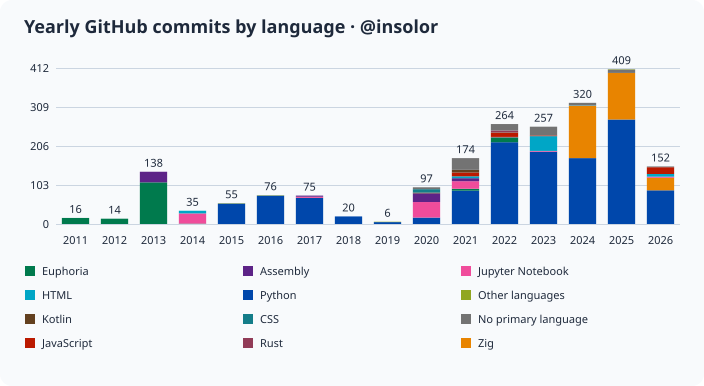

# Contributions by language

A command-line tool that generates a stacked bar chart in SVG format for a GitHub profile README. Each bar shows the selected period's commit contributions for a calendar year, grouped by the primary language of each repository.

## Generate the chart

Run with Python 3.14 and uv. Supply a GitHub token in `GITHUB_TOKEN` or `GH_TOKEN`. If you already use an authenticated GitHub CLI, you can pass its token for this command only.

```sh
GITHUB_TOKEN="$(gh auth token)" uv run contributions-by-language insolor --years 5
```

Copy the generated `contributions.svg` to the root of your profile repository (for example, `insolor/insolor`) and add this to its README.

```markdown

```

Run the command again to refresh the chart. Use `--output path.svg` to write directly to an existing local checkout of the profile repository.
The command reports how many months it has fetched from GitHub on standard error.

The default theme is light. To generate a dark chart as a separate SVG, run:

```sh
uv run --env-file .env contributions-by-language insolor --theme dark --output contributions-dark.svg
```

## Include all available history

```sh
uv run --env-file .env contributions-by-language insolor --all-time
```

With `GITHUB_TOKEN` or `GH_TOKEN` already set in your environment, omit `--env-file .env`.
The chart starts with the earliest month that has a visible public commit contribution and
includes years without activity through the current year. Use `--years N`
to show the current UTC year and the preceding `N - 1` calendar years. The default
is five years unless a period is set in the settings file.

## Settings file

The command loads `contributions.toml` from the current directory if it exists.

```toml
login = "insolor"
all_time = true
theme = "dark"
max_colors = 6
force_other_languages = ["SCSS", "Jupyter Notebook", "JavaScript"]
output = "contributions-dark.svg"
```

With the GitHub token in `.env`, run the command without repeating those settings:

```sh
uv run --env-file .env contributions-by-language
```

Use `--config path/to/settings.yaml` to select another file. TOML, YAML and JSON
are supported. Command-line arguments take priority over file settings. For
example, `--years 3` overrides `all_time = true`. The settings file can use
either `all_time = true` or `years = 3`, and can also set `refresh_cache` to a
boolean. Keep the token in `GITHUB_TOKEN` or `GH_TOKEN`.

Languages listed in `force_other_languages` always go under **Other languages**.
Language names are matched case-insensitively.

Commit counts appear in the legend by default. Set `show_legend_counts = false`
in the settings file or pass `--no-show-legend-counts` to hide them. Pass
`--show-legend-counts` to enable them again for a run.

## Daily updates with GitHub Actions

Add a repository Actions secret named `CONTRIBUTIONS_TOKEN` containing the
GitHub token used to read contribution data. The **Update contributions chart**
workflow runs daily at 01:00 UTC and can also be started from the Actions tab.
It reads `contributions.toml` and pushes changes to the generated SVG and
historical cache to the default branch using the workflow's GitHub token.
The separate **Check contributions chart** workflow verifies SVG generation
from the committed cache on pushes and pull requests. It uses read-only
permissions and requires no contribution token.

## Local cache

The first run downloads the requested history. Subsequent runs reuse completed UTC
months from the local cache and fetch the current month again. In `--all-time`
mode, the list of contribution years is refreshed on each run.

Each year is a JSONL file under `cache/github-<login>/YYYY.jsonl` in the current
Git repository. Each line records a completed month and its language counts.
Outside a Git
repository, the cache goes in the current directory. You can commit these files
and reuse them in another checkout. They contain only language names and commit
counts from public repositories. Use `--refresh-cache` to fetch the requested
months again, for example after a repository's primary language changes.

## What the chart counts

- GitHub [commit contributions](https://docs.github.com/en/graphql/reference/users#createdcommitcontribution) for public repositories. Issues, pull requests, reviews and contributions the API token cannot see are excluded.
- Each commit is assigned to the repository's [primary language reported at fetch time](https://docs.github.com/en/graphql/reference/objects#repository). For multilingual repositories, all of their commits go into that one language.
- Months are in UTC and include the current partial month. Set `max_colors` in the file or pass `--max-colors` to limit the palette to 2–12 colors (default: 6). The limit includes **No primary language** in gray and **Other languages** in yellow-green when those categories appear.
